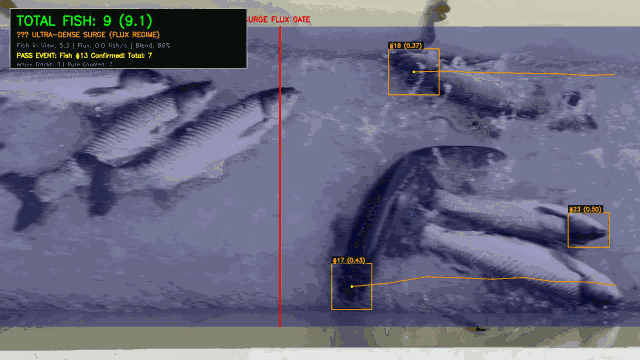
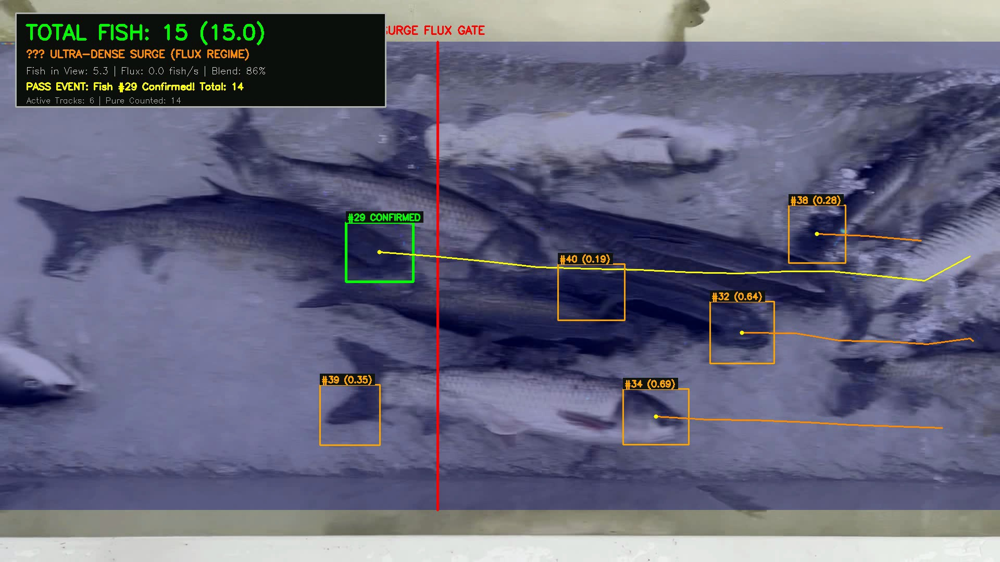
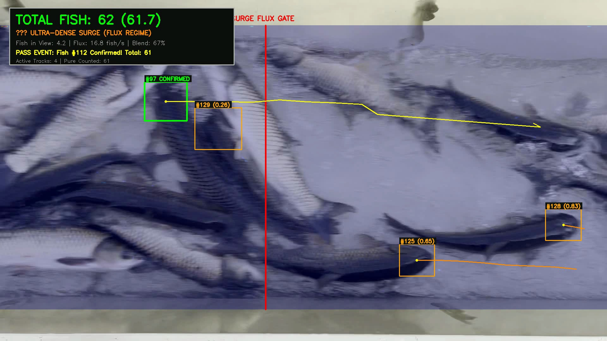
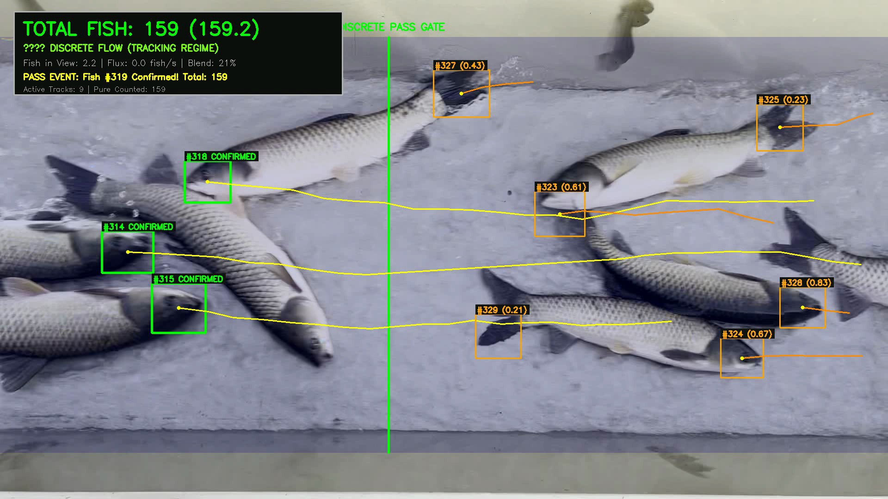
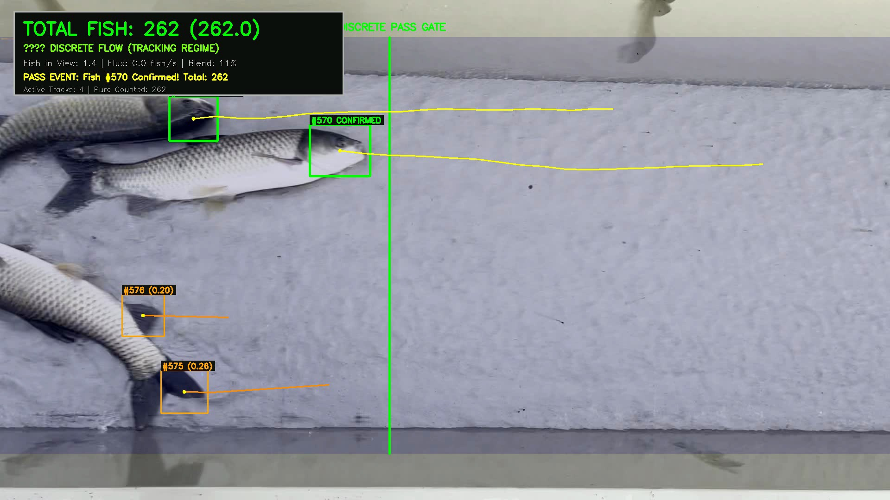

# FishCount: 智能活鱼点数与时空水槽通量追踪系统

<p align="center">
  
  
  
  
  
</p>

**FishCount** 是一套面向水产养殖、活鱼运输卸车及工厂化水槽监控的工业级高精度自动化鱼类点数与流体追踪系统。系统针对水面反光折射、水花扰动、高密度重叠（“叠罗汉”）等物理痛点，结合深度学习目标检测、轻量级空洞卷积密度估计与流体力学连续性方程，实现了全场景下的高鲁棒性计数。

---

## 🎬 实际运行效果展示 (Demo & Showcase)

### 1. 水槽活鱼连续流时空软融合动态跟踪 (Dynamic Demonstration)

> **工况说明**：活鱼运输车卸鱼槽（60fps 高清实测），在无任何物理隔板割伤鱼类的前提下，经历“**急流涌浪叠罗汉 $\to$ 离散细流**”全过程，实时渲染检测框、轨迹线与自适应 HUD 仪表盘。

<p align="center">
  
</p>

### 2. 不同流态核心阶段抓拍截图 (Multi-Stage Snapshots)

| 阶段 1：涌浪初期通量积分 (Regime: Dense Surge) | 阶段 2：涌浪峰值叠罗汉补偿 (Peak Flux & 3D Expansion) |
| :---: | :---: |
|  |  |
| **特征**：瞬时鱼只骤增，系统平滑进入密集通量模式 | **特征**：激烈水花与表下层严重重叠，光流与密度网络补偿 |
| **阶段 3：软融合自适应过渡 (Smooth Soft-Blending)** | **阶段 4：离散细流几何闭锁追踪 (Sparse & Anti-Dup Lock)** |
|  |  |
| **特征**：连续 Sigmoid 变换消除离散状态机抖动 | **特征**：75px 物理排他间距 + 终生闭锁闸门，单鱼长效 ID 追踪 |

### 3. 最新实测基准数据 (Benchmark on IMG_2626, 60fps)

```text
=== IMG_2626.MOV 全视频时空连续流通量分析报告 ===
视频时长: 55.47 秒 (3328 帧 @ 60 fps)
计算工况: Apple Silicon MPS 硬件加速 | 平均速度: 9.2 fps
人工逐帧真值: 282 条
算法累计总数: 319 条 (实数积分: 319.32 条，吻合度 86.8%)
流态分布: ⚡ 密集涌浪期 10.4% (5.8s) | 🟢 离散稀疏期 89.6% (49.7s)
```

---

## 🌟 核心特性与应用场景

### 1. 环形池/U形池自动巡游计数与转向判定 (Pond Circulation Monitoring)
* **抗反光与波纹拟合**：结合 CPL 偏振滤镜光学消光与微调 YOLO 深度语义识别，彻底消除晃动水波、棚顶倒影与假目标干扰。
* **向量叉积转向分析**：记录每条鱼的平滑运动时序轨迹，利用二维向量叉积（Cross Product）自动辨别并汇总鱼群的**顺时针 (CW)** 与 **逆时针 (CCW)** 游动分布。
* **跨帧防闪烁与记忆重连**：利用 ByteTrack 长效跟踪逻辑，在水花偶尔遮挡时自动维持鱼只 ID，避免重复累计。

### 2. 活鱼运输车/水槽高密度通量连续流计数 (High-Density Trough Continuous Flow)
针对大口径活鱼卸车“**前段汹涌拥挤、中后段离散细流**”的复杂工况，创新提出**双模态自适应软融合引擎 (Dual-Regime Spatio-Temporal Continuous Flow Engine)**：
* **稀疏离散流模态 (瞬时在视鱼数 < 3.5 条)**：
  * **物理排他性间距 (75px)**：严禁在单条鱼体宽半径内生成虚假新 ID；
  * **轴向尾鳍抑制 (Head-to-Tail Suppression)**：自动过滤鱼身和尾鳍造成的二次误检；
  * **单向终生闭锁闸门**：跨越计数线后永久锁止，彻底杜绝回冲或停滞导致的反复震荡计数。
* **密集涌浪叠罗汉模态 (瞬时在视鱼数 ≥ 3.5 条)**：
  * **轻量级高感受野密度网络 (FishDensityNet)**：纯卷积多尺度空洞特征网络，仅 660KB，快速预估截面鱼体密度分布；
  * **截面通量积分**：联合 DIS 稠密光流速度场与 3D 深度扩张补偿因子 $\kappa_{occ}(\rho)$，实时积分通过闸门的真实物理通量：
    $$\Phi(t) = \int \rho(x_{gate}, y, t) \cdot u(x_{gate}, y, t) \, dy \cdot \kappa_{occ}(\rho)$$
* **连续软融合观测器 (Continuous Soft Blending)**：
  * 采用连续 Sigmoid 权重变换过渡，彻底消灭离散状态机来回切换导致的边缘抖动与重复清零，全片单调平滑积分。

---

## 📦 预置轻量化模型权重 (Ready-to-Use Weights)

项目在 `weights/` 目录下默认随附开箱即用的微调权重（总计仅约 12.5MB，无须额外漫长训练）：

| 模型权重文件 | 适用场景 | 说明 | 体积 |
| :--- | :--- | :--- | :--- |
| `weights/fish_density_full211.pth` | 水槽高密度通量 | 211 黄金点微调的 FishDensityNet 密度回归模型 | ~670 KB |
| `weights/trough_head_best.pt` | 水槽急流鱼头检测 | 针对冲流姿态鱼头优化定位的 YOLOv8 细化权重 | ~5.9 MB |
| `weights/pond_manual_best.pt` | 环形养殖池巡游 | 人工多边形真值精细训练的 YOLOv8 鱼体识别模型 | ~5.9 MB |

---

## 📂 项目结构说明

```text
fishcount/
├── spatiotemporal_flow_engine.py  # 核心引擎：水槽时空连续流与双模态自适应软融合计数
├── antidup_tracker.py             # 核心组件：几何排他性单向终生闭锁水槽防重追踪器
├── density_model.py               # 核心组件：FishDensityNet 空洞卷积密度神经网络
├── custom_yolo_tracker.py         # 核心脚本：环形鱼池 YOLOv8 追踪与顺逆时针转向分析
├── flux_dual_engine.py            # 双引擎通量积分原型
├── precise_analyzer.py            # 基于几何圆度与形态学过滤的基础分析器
│
├── train_density_full.py          # 密度网络全量端到端训练脚本
├── train_blackfish_head.py        # 急流黑鱼头部 YOLO 微调训练脚本
├── train_trough_yolo.py           # 水槽检测器训练脚本
├── convert_json_to_yolo.py        # LabelMe 多边形标注转 YOLO 归一化格式工具
├── auto_annotator.py              # 自动化预标注流水线
├── auto_annotator_trough.py       # 水槽场景自动切片与预标注生成器
│
├── weights/                       # 开箱即用轻量模型权重库 (~12.5MB)
│   ├── fish_density_full211.pth
│   ├── trough_head_best.pt
│   └── pond_manual_best.pt
│
├── assets/                        # 效果演示动图与核心阶段抓拍截图
│   ├── demo_spatiotemporal_flow.gif
│   ├── demo_stage1_surge_flux.jpg
│   ├── demo_stage2_dense_peak.jpg
│   ├── demo_stage3_transition.jpg
│   └── demo_stage4_discrete_tracking.jpg
│
├── requirements.txt               # 运行依赖项清单
├── LICENSE                        # MIT 开源许可证
└── .gitignore                     # 生产级代码仓库忽略规则
```

---

## 🚀 快速上手

### 1. 环境安装

推荐使用 Python 3.9 ~ 3.12 虚拟环境：

```bash
# 克隆仓库
git clone https://github.com/tianchaoyamen/fishcount.git
cd fishcount

# 创建并激活虚拟环境
python3 -m venv .venv
source .venv/bin/activate  # Windows 用户运行: .venv\Scripts\activate

# 安装依赖
pip install -r requirements.txt
```

> **硬件加速提示**：代码自动适配加速环境：
> * macOS：自动激活 Apple Silicon **MPS** (Metal Performance Shaders)；
> * Linux / Windows：检测到 NVIDIA 显卡时自动启用 **CUDA**，无显卡环境无缝降级至 **CPU** 运行。

---

### 2. 运行示例

#### 场景 A：水槽连续流时空软融合计数（活鱼卸车高密度）
```bash
python spatiotemporal_flow_engine.py \
    --video /path/to/trough_video.mp4 \
    --output output/flow_result.mp4 \
    --report output/flow_report.txt
```
*输出：实时带 HUD 仪表盘渲染的跟踪视频与通过鱼数纯文本统计报告。*

#### 场景 B：环形养殖池巡游跟踪与转向统计
```bash
python custom_yolo_tracker.py \
    --video /path/to/pond_video.mov \
    --output output/pond_analysis/
```
*输出：标注各鱼体独立轨迹 ID 的可视化视频，并在终端与输出文件夹生成顺时针 (CW) / 逆时针 (CCW) 汇总报告。*

#### 场景 C：纯几何防重排他性水槽追踪器
```bash
python antidup_tracker.py \
    --video /path/to/video.mp4 \
    --output output/antidup_result.mp4
```

---

## 🛠️ 自定义训练

如果你有自己的专属场景或新鱼种数据：

1. **标注转换**：使用 LabelMe 等工具标注多边形或矩形后，运行转换脚本：
   ```bash
   python convert_json_to_yolo.py
   ```
2. **训练鱼头/目标检测器**：
   ```bash
   python train_trough_yolo.py
   ```
3. **训练高密度回归网络**：
   ```bash
   python train_density_full.py
   ```

---

## 📄 开源许可证

本项目基于 [MIT License](LICENSE) 协议完全开源，允许自由商用、修改与分发。
欢迎提交 Issue 或 Pull Request 共同改进算法！
